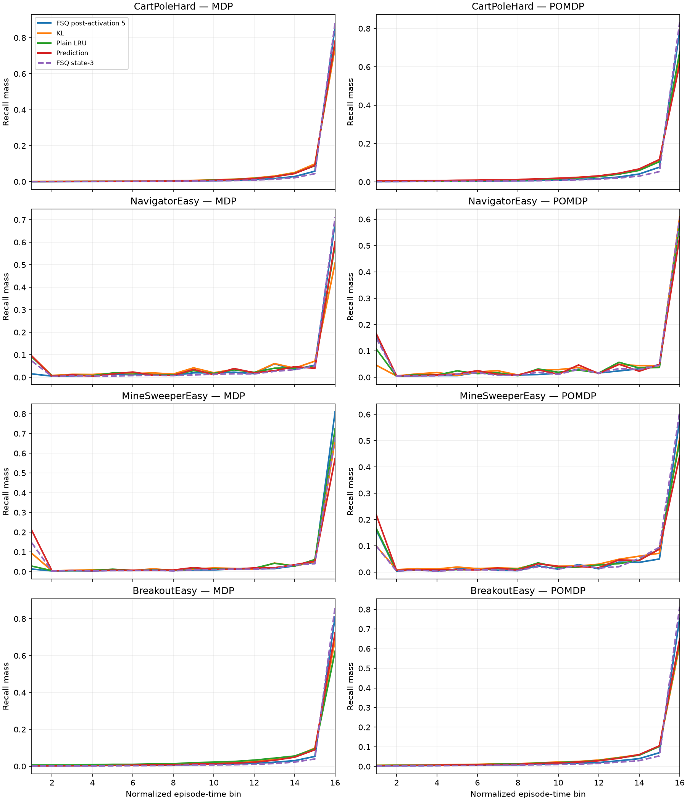

# LRU intervention results

The indexed comparison covers four tasks and four interventions, including the November 22 FSQ state-3 training suite. Each reported run used 98,304 actual training steps (100,000 requested) and 64 held-out evaluation episodes. Inputs were previous action, previous reward, and current observation.

## Metrics

- **MDP return** is $J(f,\pi,M)$ and **POMDP return** is $J(f,\pi,P)$. The artifacts contain separately trained and evaluated policies for each observation mode, so the gap compares those mode-specific runs. A fixed-policy gap would require evaluating the same checkpoint in both modes.
- **Observability gap** is $J(f,\pi,M)-J(f,\pi,P)$. A positive gap means higher return in MDP.
- **Memory bias** is $J(f,\pi,M)-J(\pi,M)$, using the plain feedforward MLP as the memoryless reference. Negative bias means the recurrent model scored below the MLP.
- The decomposition is $J(f,\pi,P)=J(\pi,M)+\mathrm{Bias}-\mathrm{Gap}$. Differences were computed before rounding.

## Complete indexed checkpoint comparison

The final checkpoint index contains four tasks, five conditions, both observation modes and seeds 0–2. FSQ in the indexed results denotes five-level post-activation quantization. FSQ state-3 quantizes the carried recurrent state to three levels at scale 1.0. Each row below averages the three independently trained policies and their 64-episode evaluations. Gap is the mean of seed-paired differences; MDP and POMDP policies are trained separately. These plain LRU checkpoints differ from the earlier sweep controls below. Training device varies between runs and can be confounded with seed.

| Task | Condition | MDP | POMDP | Gap | Gap SD |
|---|---|---:|---:|---:|---:|
| CartPoleHard | Plain LRU | 0.501892 | 0.310460 | +0.191432 | 0.070562 |
| CartPoleHard | KL | 0.436909 | 0.304340 | +0.132569 | 0.125324 |
| CartPoleHard | Prediction | 0.572543 | 0.307621 | +0.264922 | 0.029707 |
| CartPoleHard | FSQ | 0.607309 | 0.364904 | +0.242404 | 0.135930 |
| CartPoleHard | FSQ state-3 | 0.586163 | 0.305503 | +0.280659 | 0.030825 |
| NavigatorEasy | Plain LRU | 0.120361 | -0.009399 | +0.129761 | 0.142086 |
| NavigatorEasy | KL | 0.052897 | 0.092773 | -0.039876 | 0.518615 |
| NavigatorEasy | Prediction | 0.162598 | 0.204102 | -0.041504 | 0.108094 |
| NavigatorEasy | FSQ | 0.044881 | -0.145630 | +0.190511 | 0.309204 |
| NavigatorEasy | FSQ state-3 | -0.119629 | -0.045207 | -0.074422 | 0.190238 |
| MineSweeperEasy | Plain LRU | 0.400112 | 0.326451 | +0.073661 | 0.058178 |
| MineSweeperEasy | KL | 0.428106 | 0.314825 | +0.113281 | 0.027476 |
| MineSweeperEasy | Prediction | 0.394624 | 0.345796 | +0.048828 | 0.006490 |
| MineSweeperEasy | FSQ | 0.387835 | 0.335380 | +0.052455 | 0.048028 |
| MineSweeperEasy | FSQ state-3 | 0.407273 | 0.331659 | +0.075614 | 0.035239 |
| BreakoutEasy | Plain LRU | -0.814731 | -0.837717 | +0.022986 | 0.014392 |
| BreakoutEasy | KL | -0.793915 | -0.823099 | +0.029184 | 0.030227 |
| BreakoutEasy | Prediction | -0.680425 | -0.796641 | +0.116215 | 0.097041 |
| BreakoutEasy | FSQ | -0.749349 | -0.820781 | +0.071432 | 0.137231 |
| BreakoutEasy | FSQ state-3 | -0.749549 | -0.805564 | +0.056016 | 0.103722 |

[Indexed seed returns and provenance](lru_interventions_data/indexed_returns.csv) · [FSQ state-3 training and evaluation records](lru_interventions_data/sources/results/fsq_state3_local_20261122/RESULTS.json) · [Earlier seed metrics](lru_interventions_data/metrics_by_seed.csv) · [Earlier three-seed summary](lru_interventions_data/metrics_three_seed.csv)

The indexed policies also have whole-trajectory recall measurements, using five episodes per checkpoint and 16 normalized-time bins. Gradient-based recall measures how much observations at each point in an episode contribute to the final action distribution. The plot includes FSQ state-3 recall for all four tasks in both modes, using 120 episodes across 24 checkpoints. [Recall density CSV](lru_interventions_data/recall_density.csv) · [Original recall manifest](lru_interventions_data/sources/results/recall_density_16_main_final/manifest.json) · [FSQ state-3 recall manifest](lru_interventions_data/sources/results/recall_density_16_fsq_state3/manifest.json).

## CartPoleHard KL and next-observation prediction

All rows average seeds 0–2. Bias is the mean of seed-matched differences against the plain MLP MDP reference. Vanilla LRU is the control from the prediction suite; it differs from the indexed plain LRU above. Device varies across runs and is confounded with seed for some runs.

| Condition | MDP return | POMDP return | Gap | Gap SD | Bias |
|---|---:|---:|---:|---:|---:|
| Vanilla LRU | 0.486319 | 0.270312 | +0.216007 | 0.048277 | -0.148038 |
| KL auxiliary loss (default IB) | 0.436909 | 0.304340 | +0.132569 | 0.125324 | -0.197448 |
| LRU + next-observation and reward prediction | 0.572543 | 0.307621 | +0.264922 | 0.029707 | -0.061814 |
| Default IB + prediction | 0.515329 | 0.280972 | +0.234357 | 0.145132 | -0.119028 |

Prediction improved mean MDP and POMDP return over this vanilla control by 0.086224 and 0.037309 respectively; its mean gap increased. Default IB had a lower mean MDP return and higher mean POMDP return than this control. These are descriptive comparisons across three seeds.

Default IB uses reverse KL (posterior relative to prior), LRU output as posterior memory input, posterior statistics plus current input in the actor and critic, gradient weights of 0.4/1.6 for the prior and posterior, a one-bit free region per Gaussian distribution, and frozen RMS normalization with coefficient 1. Prediction uses coefficient 1 and jointly predicts the next 512-dimensional CNN embedding and reward for the action taken. Terminal embeddings are masked, and prediction gradients are stopped on both CNN paths. The prediction gain therefore covers the joint objective.

[Prediction results](lru_interventions_data/sources/results/lru_input_prediction_20261111/RESULTS.md) · [Run design](lru_interventions_data/sources/results/lru_input_prediction_20261111/EXPERIMENT.md) · [Plain MLP MDP result](lru_interventions_data/sources/results/lru_input_prediction_20261111/CartPoleHard/mdp/mlp_seed0/result.json)

## CartPoleHard FSQ sweep

This section reports the original sweep. The indexed FSQ state-3 row above uses newly trained CartPoleHard checkpoints.

FSQ uses scalar levels of 3, 5, or 7 at scale 1. State FSQ quantizes the carried state, pre-readout FSQ quantizes the state used by the readout while carrying continuous state, and post-activation FSQ quantizes the activated output. The continuous control comes from the original FSQ sweep. All rows use seeds 0, 1, and 2 with the same per-run budget and evaluation count as above.

The main columns average the three seed-level returns and paired gaps. Gap SD is the sample standard deviation across training seeds. Bias averages the three seed-matched MDP differences against plain MLP. The MLP MDP returns were 0.705572, 0.520546, and 0.676953 for seeds 0–2. The seed-2 MLP ran on a Colab T4, while all FSQ runs used an RTX 2060.

| Condition | MDP return | POMDP return | Gap | Gap SD | Bias |
|---|---:|---:|---:|---:|---:|
| Continuous LRU | 0.605182 | 0.307291 | +0.297890 | 0.159962 | -0.029175 |
| State FSQ, 3 levels | 0.674236 | 0.302760 | +0.371475 | 0.165109 | +0.039878 |
| State FSQ, 5 levels | 0.645460 | 0.294739 | +0.350720 | 0.150268 | +0.011102 |
| State FSQ, 7 levels | 0.657725 | 0.305373 | +0.352352 | 0.052849 | +0.023368 |
| Pre-readout FSQ, 3 levels | 0.562656 | 0.364826 | +0.197830 | 0.041135 | -0.071701 |
| Pre-readout FSQ, 5 levels | 0.650772 | 0.291015 | +0.359757 | 0.234504 | +0.016415 |
| Pre-readout FSQ, 7 levels | 0.648619 | 0.317014 | +0.331606 | 0.112800 | +0.014262 |
| Post-activation FSQ, 3 levels | 0.629999 | 0.347769 | +0.282231 | 0.163530 | -0.004358 |
| Post-activation FSQ, 5 levels | 0.607309 | 0.364904 | +0.242404 | 0.135930 | -0.027049 |
| Post-activation FSQ, 7 levels | 0.468576 | 0.331041 | +0.137535 | 0.071393 | -0.165781 |
| State + post-activation FSQ, 3 levels | 0.673819 | 0.324383 | +0.349435 | 0.017304 | +0.039462 |
| State + post-activation FSQ, 5 levels | 0.661527 | 0.335555 | +0.325972 | 0.075091 | +0.027170 |
| State + post-activation FSQ, 7 levels | 0.642604 | 0.308663 | +0.333941 | 0.085446 | +0.008247 |

Five-level post-activation FSQ had the highest mean POMDP return (0.364904 versus 0.307291 for continuous LRU) and a smaller gap (0.242404 versus 0.297890). Seven-level post-activation FSQ had a smaller gap still (0.137535), alongside a lower MDP return than the continuous control. These comparisons are descriptive across three seeds and multiple configurations.

[Follow-up seed metrics](lru_interventions_data/metrics_by_seed.csv) · [FSQ three-seed summary](lru_interventions_data/metrics_three_seed.csv) · [FSQ design](lru_interventions_data/sources/docs/fsq/README.md)

## Additional KL results

The residual ablation was run only at seed 0, so three-seed averages are unavailable for the residual-disabled configuration. Its paired results and the earlier 16-configuration divergence sweep remain available in the source files. The three-seed default KL results for all four tasks are shown in the indexed comparison above.

[Residual ablation results](lru_interventions_data/sources/results/default_ib_no_residual_20261109/summary.csv) · [Divergence sweep](lru_interventions_data/sources/results/posterior_rms_suite_20261109/summary.csv)

## Missing results

- **Longer-budget KL results** are unavailable in the million-step directory, which has no completed evaluation results. The final-output-only prediction pilot was superseded before its prediction run finished. The completed prediction variant above uses current input in its prediction heads.

[Million-step KL status](lru_interventions_data/sources/results/ib_million_steps_20261109/RESULTS.md) · [Superseded prediction pilot](lru_interventions_data/sources/results/lru_prediction_20261111/EXPERIMENT.md)
