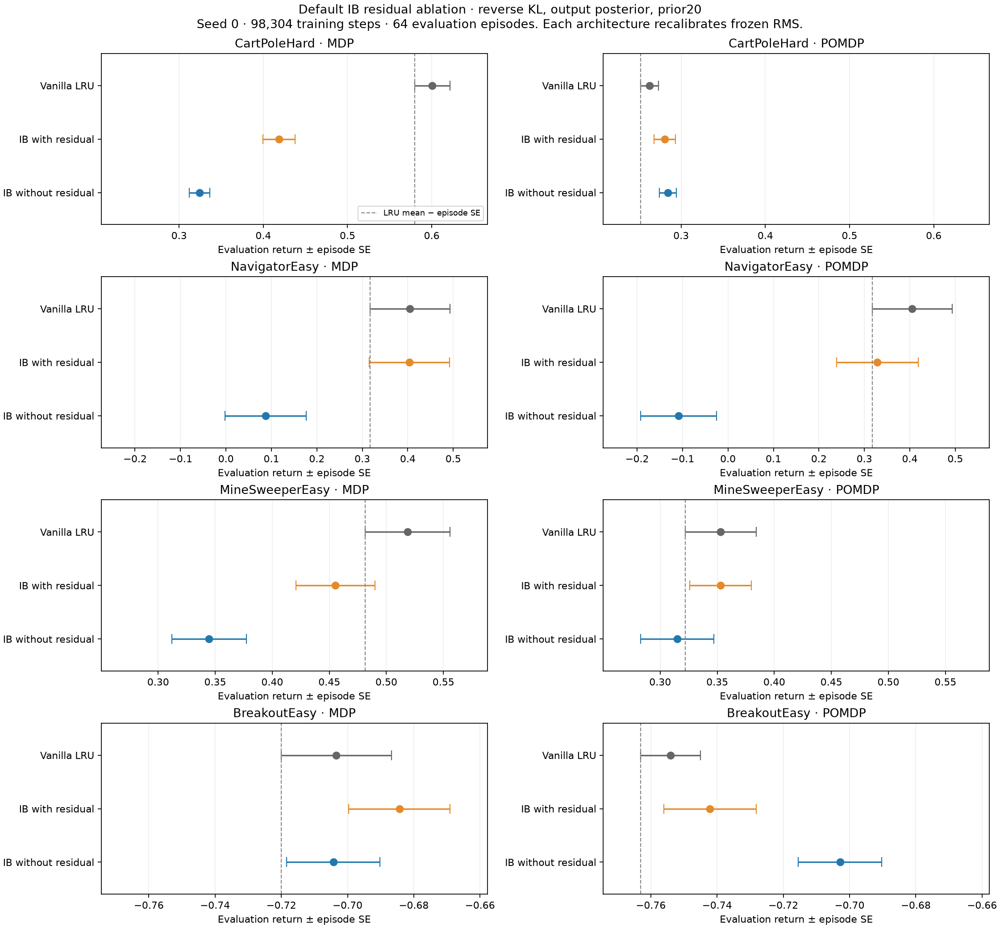
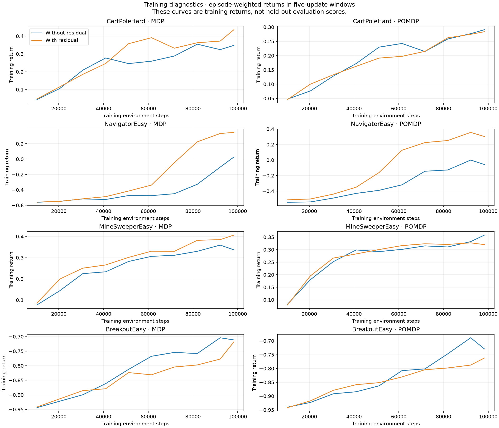

# Default IB: residual ablation

**8/8 local-GPU runs complete; artifact audit passed.** Reverse KL `KL(posterior || prior)`, output posterior input, prior20 (auxiliary prior/posterior gradient weights 0.4/1.6). Both RL heads receive current input plus posterior mean/log variance. Each run uses seed 0, 98,304 actual training steps (100,000 requested), and 64 held-out evaluation episodes.

[All scores and deltas](summary.csv) · [Audit](audit.json) · [Calibration scales](reports/calibration.csv) · [Artifact checksums](provenance/artifact_manifest.json) · [Run manifest](manifest.json)

## Observed effect

Disabling residuals lowered the mean return in **6/8 settings** and increased it in **2/8**. It meets `IB mean ≥ vanilla LRU mean − vanilla LRU episode SE` in **3/8**, versus **6/8** with residuals. The current residual-enabled default remains unchanged.

Largest mean-return drops: NavigatorEasy POMDP (-0.4375), NavigatorEasy MDP (-0.3159). Mean-return increases: BreakoutEasy POMDP (+0.0393), CartPoleHard POMDP (+0.0039). These are single-training-seed observations, not evidence of reproducible gains or losses across seeds.



## Scores

± is episode SE, conditional on one trained policy. Δ is **without residual minus with residual**. The threshold is descriptive, not a statistical equivalence test.

| Task | Mode | IB without residual ± SE | IB with residual ± SE | Δ | Vanilla LRU ± SE | Without ≥ LRU−SE | With ≥ LRU−SE |
|---|---|---:|---:|---:|---:|---|---|
| [CartPoleHard](CartPoleHard/mdp/ib_reverse_prior20_seed0/result.json) | MDP | 0.3243 ± 0.0122 | 0.4186 ± 0.0192 | -0.0942 | 0.6007 ± 0.0210 | no | no |
| [CartPoleHard](CartPoleHard/pomdp/ib_reverse_prior20_seed0/result.json) | POMDP | 0.2842 ± 0.0099 | 0.2803 ± 0.0127 | +0.0039 | 0.2624 ± 0.0106 | yes | yes |
| [NavigatorEasy](NavigatorEasy/mdp/ib_reverse_prior20_seed0/result.json) | MDP | 0.0875 ± 0.0893 | 0.4034 ± 0.0881 | -0.3159 | 0.4049 ± 0.0879 | no | yes |
| [NavigatorEasy](NavigatorEasy/pomdp/ib_reverse_prior20_seed0/result.json) | POMDP | -0.1088 ± 0.0834 | 0.3287 ± 0.0897 | -0.4375 | 0.4050 ± 0.0879 | no | yes |
| [MineSweeperEasy](MineSweeperEasy/mdp/ib_reverse_prior20_seed0/result.json) | MDP | 0.3446 ± 0.0328 | 0.4554 ± 0.0347 | -0.1108 | 0.5187 ± 0.0371 | no | no |
| [MineSweeperEasy](MineSweeperEasy/pomdp/ib_reverse_prior20_seed0/result.json) | POMDP | 0.3150 ± 0.0322 | 0.3530 ± 0.0271 | -0.0379 | 0.3530 ± 0.0311 | no | yes |
| [BreakoutEasy](BreakoutEasy/mdp/ib_reverse_prior20_seed0/result.json) | MDP | -0.7043 ± 0.0141 | -0.6843 ± 0.0153 | -0.0199 | -0.7034 ± 0.0167 | yes | yes |
| [BreakoutEasy](BreakoutEasy/pomdp/ib_reverse_prior20_seed0/result.json) | POMDP | -0.7029 ± 0.0126 | -0.7422 ± 0.0139 | +0.0393 | -0.7541 ± 0.0090 | yes | yes |

## Controls and limits

PPO settings, seed, training budget, evaluation count, model sizes, Gaussian dimension, balancing weights, posterior head inputs, and parameter counts match the residual-enabled IB references. Both IB conditions have 16,407,454 parameters. Vanilla LRU has 6,940,422 parameters and a different head; it has no added inter-layer residual.

The auxiliary objective is the sum of actor/critic sample means of `max(D_bits − 1, 0) / frozen_RMS_bits`, coefficient 1. Each architecture recalibrates its own branch-specific RMS scales on 2,048 random-policy samples. All eight calibration-trajectory hashes match their residual-enabled references. Removing residuals also changes the frozen RMS scales, so this is an ablation under the same normalization procedure rather than a fixed-loss-coefficient isolation of residuals.

All new runs use the local RTX 2060. Residual-enabled MDP references used that GPU; POMDP references used Colab T4. Device provenance is retained in the CSV. Episode SE does not measure training-seed variability. Scores are never averaged across tasks.

## Training diagnostics

The curves compare the same preset with and without residuals; no best-configuration selection is performed here. Five-update windows weight returns by completed episodes.



## Artifact layout and reproduction

Each `Task/{mdp,pomdp}/ib_reverse_prior20_seed0/` directory keeps the checkpoint, original metadata, per-episode returns, and training log. Fresh calibration files remain under each mode's `_calibration/` directory. `provenance/source/` and `provenance/source_snapshot.tar.gz` preserve training source. The original runner and execution logs remain intact.

Reference result metadata, evaluation arrays, and training logs are bundled under `provenance/references/`, allowing this report to regenerate after older result directories are deleted. Reference checkpoints are not duplicated.

```bash
JAX_PLATFORMS=cpu uv run python -m popgym_arcade.experiments.report_residual_ablation results/default_ib_no_residual_20261109
```

Standalone plots: [PNG](reports/comparison.png), [PDF](reports/comparison.pdf).
