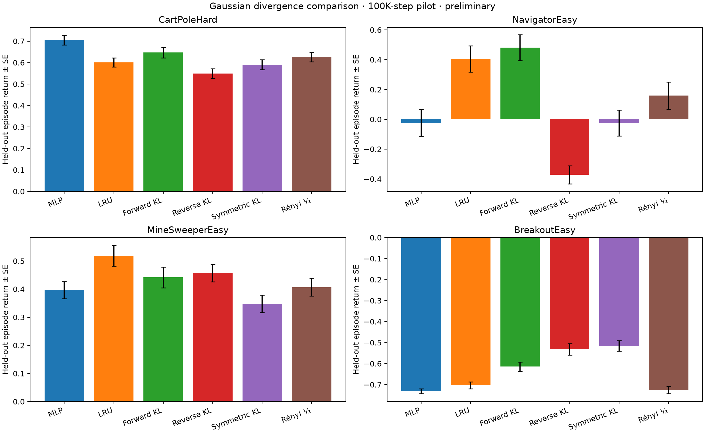

# Multi-task divergence pilot

4 task families, fully observed mode, training seeds [0]. Completed 24/24 runs. Scores are held-out stochastic-policy episode returns; scores are not averaged across different tasks.

| Task | MLP | LRU | Forward KL | Reverse KL | Symmetric KL | Rényi ½ |
|---|---:|---:|---:|---:|---:|---:|
| CartPoleHard | 0.7056 | 0.6007 | 0.6468 | 0.5486 | 0.5901 | 0.6259 |
| NavigatorEasy | -0.0240 | 0.4049 | 0.4803 | -0.3722 | -0.0242 | 0.1594 |
| MineSweeperEasy | 0.3968 | 0.5187 | 0.4417 | 0.4570 | 0.3477 | 0.4071 |
| BreakoutEasy | -0.7317 | -0.7034 | -0.6143 | -0.5325 | -0.5157 | -0.7263 |

Memory bias (MLP score − condition score; lower is better):

| Task | LRU | Forward KL | Reverse KL | Symmetric KL | Rényi ½ |
|---|---:|---:|---:|---:|---:|
| CartPoleHard | +0.1049 | +0.0587 | +0.1570 | +0.1155 | +0.0797 |
| NavigatorEasy | -0.4290 | -0.5044 | +0.3481 | +0.0001 | -0.1835 |
| MineSweeperEasy | -0.1219 | -0.0449 | -0.0603 | +0.0491 | -0.0103 |
| BreakoutEasy | -0.0283 | -0.1174 | -0.1992 | -0.2160 | -0.0054 |

Observed comparisons (point estimates, not significance tests):

- CartPoleHard: best observed IB is forward_kl (score 0.6468), a score change of +0.0461 versus LRU.
- NavigatorEasy: best observed IB is forward_kl (score 0.4803), a score change of +0.0754 versus LRU.
- MineSweeperEasy: best observed IB is reverse_kl (score 0.4570), a score change of -0.0617 versus LRU.
- BreakoutEasy: best observed IB is symmetric_kl (score -0.5157), a score change of +0.1878 versus LRU.

Observed wins over LRU on completed tasks: forward_kl: 3/4; reverse_kl: 1/4; symmetric_kl: 1/4; renyi_half: 1/4. No raw-score average across tasks is used.

Negative memory bias means the condition outperformed the MLP reference. A positive memory deficit is not present in every task's baseline; reductions in the signed gap are equivalent to improvements in score versus LRU.

All agents receive `(previous action, previous reward, current observation)`. Every bottleneck head receives `(input, prior mean, prior log variance)`, with no latent sampling. Each actor/critic Gaussian has 1,365 coordinates (floor(2/3 × 2,048 real scalar LRU-state dimensions)). The posterior uses the current full LRU state. All bottlenecks use `max(1, divergence_bits)`, summed over the full Gaussian event, averaged over samples, then summed across actor and critic with coefficient 1. Symmetric KL is the average of both KL directions. Rényi-½ is twice the Bhattacharyya distance. All have exact closed forms; no Monte Carlo divergence estimator is used.

This is a 100K-requested-step pilot (98,304 actual steps per model), with upstream PPO hyperparameters, 64 held-out episodes per model, and a learning-rate schedule spanning the pilot. Conditional episode SEs are in summary.csv; they do not capture variability across training seeds. Divergence values have different geometries despite common bit units and coefficient; regularization strengths are not locally calibrated. No coefficient tuning was performed. All IB policies have no recurrent-state inference path; the memory is auxiliary during training. Model sizes differ between LRU and IB, while all four IB variants have identical architectures and initial parameters.

CartPole MLP, LRU, and forward-KL results may be reused from the earlier matching pilot, with original source hashes and provenance retained. Other conditions are freshly trained. Task-specific episode horizons are used for evaluation. Per-run configs, logs, scores, and local weights are retained under each task directory.

[Divergence definitions](https://arxiv.org/abs/1206.2459) · [Experiment instructions](../../DIVERGENCE_SUITE.md) · [CSV](summary.csv)

