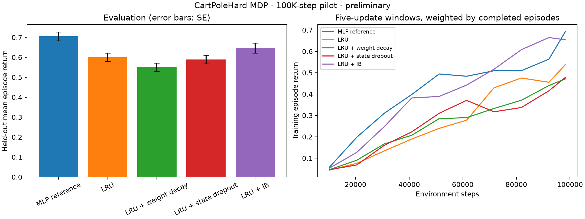

# Memory-bias pilot results

Completed on CUDA (NVIDIA GeForce RTX 2060 with Max-Q Design), JAX 0.6.2. Environment: fully observed `CartPoleHard`. Each condition used training seed 0, 98,304 environment steps, and 64 held-out evaluation episodes. The approved 100K budget was rounded down to complete 2,048-step PPO rollouts.

`memory bias = MLP reference score − condition score`. Positive bias means the reference outperformed that condition. Positive bias reduction below means an improvement over unregularized LRU.

| Condition | Held-out return ± episode SE | Memory bias | Bias reduction vs LRU | Parameters |
|---|---:|---:|---:|---:|
| MLP reference | 0.705572 ± 0.022491 | 0.000000 | — | 1,279,238 |
| LRU baseline | 0.600703 ± 0.021015 | 0.104870 | +0.000000 | 6,940,422 |
| + weight decay (1e-4) | 0.550885 ± 0.020309 | 0.154687 | -0.049818 | 6,940,422 |
| + state dropout (0.1) | 0.588932 ± 0.021705 | 0.116641 | -0.011771 | 6,940,422 |
| + information bottleneck (1 free bit) | 0.646822 ± 0.024760 | 0.058750 | +0.046120 | 24,794,014 |

Information bottleneck reduced the observed gap by **44.0%** relative to the LRU baseline. Weight decay and state dropout did not reduce the gap in this pilot.

These are single-training-seed pilot results at roughly 1% of the upstream training budget. Episode-level standard errors do not measure variation across training seeds. The results do not establish statistical significance or a general regularization benefit. The conditions also differ in parameter count, especially IB; there is no parameter-matched control.

All agents use `(a_{t-1}, r_{t-1}, o_t)`, including at rollout, PPO replay, bootstrap, and evaluation. All PPO settings were read from upstream `train.py`; the training budget and disabled external logging are the explicit overrides.

IB uses a diagonal multivariate Gaussian with 1,365 latent coordinates per actor/critic branch, computed as `floor(2/3 × 2,048)` real scalar LRU-state dimensions. Both RL heads receive `(input, prior_mean, prior_log_variance)` directly. The posterior receives `(input, LRU_state)`. KL is `KL(prior || posterior)` in bits; `max(1, KL_bits)` is applied per full distribution and per sample, separately for actor and critic, then summed with coefficient 1. The LRU has no direct inference path to the IB heads, so this variant evaluates auxiliary-memory training rather than a memory-dependent policy.

Validation: 12 CPU test cases passed, covering input ordering, resets, KL direction, free-bit units/gradients, dropout replay, GAE termination, complex-parameter gradients, and two-layer parallel/serial equivalence for LRU, dropout, and IB. A full-size CUDA check also passed, with maximum absolute logit difference below 5e-7. Ruff formatting and lint passed for the experiment code and checks.

[Experiment design and reproduction commands](../../MEMORY_BIAS.md) · [Summary CSV](summary.csv)

Each condition directory retains `config.json`, `training.jsonl`, `evaluation_returns.npy`, `result.json`, and local `model.eqx` weights. JSON metadata includes the source and dependency-lock hashes.
