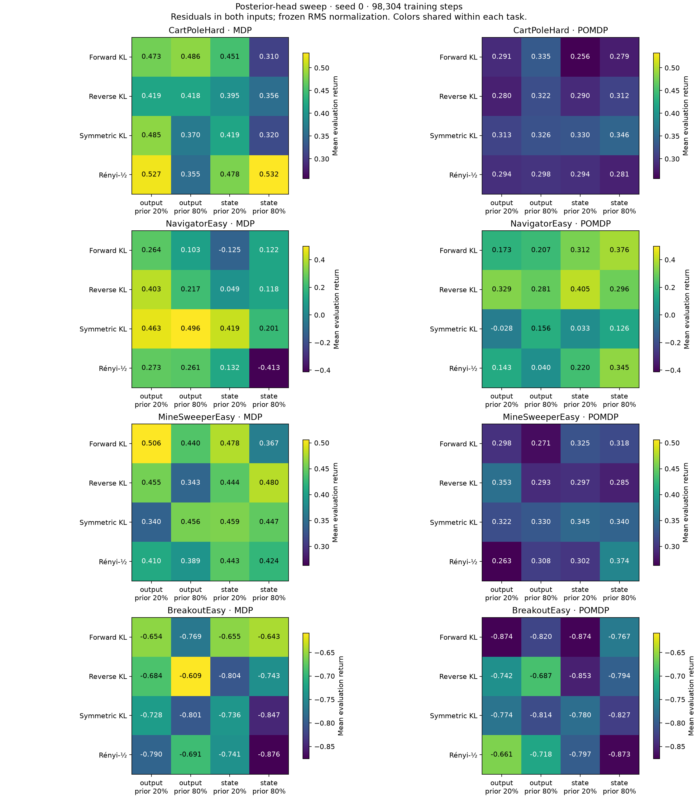

> **Default IB residual ablation:** [Eight-run comparison](../default_ib_no_residual_20261109/RESULTS.md).

# Corrected posterior-head sweep

**128/128 runs complete; artifact audit passed.** Four tasks × two observation modes × four divergences × two asymmetric balances × two posterior memory inputs. All runs use seed 0, 98,304 actual training steps (100,000 requested), and 64 held-out stochastic-policy evaluation episodes.

[All 128 runs (CSV)](summary.csv) · [Consolidated vanilla LRU baselines](../vanilla_lru_baselines_20261109/RESULTS.md) · [MDP comparison plots](reports/vs_vanilla_lru.md) · [Audit](reports/audit.json) · [Calibration scales](reports/calibration.csv) · [Factor contrasts](reports/factor_contrasts.csv) · [Source snapshot](source_snapshot.tar.gz)



## Highest observed scores by memory input

These are selected maxima across eight configurations per input, not independently validated winners. ± denotes episode SE; it does not measure training-seed variability.

| Task | Mode | Posterior input | Divergence | Prior/posterior shares | Return ± episode SE |
|---|---|---|---|---|---:|
| [CartPoleHard](reports/CartPoleHard.md) | MDP | output | Rényi-½ | 20/80 | 0.5267 ± 0.0223 |
| [CartPoleHard](reports/CartPoleHard.md) | MDP | state | Rényi-½ | 80/20 | 0.5324 ± 0.0192 |
| [CartPoleHard](reports/CartPoleHard.md) | POMDP | output | Forward KL | 80/20 | 0.3350 ± 0.0150 |
| [CartPoleHard](reports/CartPoleHard.md) | POMDP | state | Symmetric KL | 80/20 | 0.3460 ± 0.0164 |
| [NavigatorEasy](reports/NavigatorEasy.md) | MDP | output | Symmetric KL | 80/20 | 0.4965 ± 0.0839 |
| [NavigatorEasy](reports/NavigatorEasy.md) | MDP | state | Symmetric KL | 20/80 | 0.4194 ± 0.0906 |
| [NavigatorEasy](reports/NavigatorEasy.md) | POMDP | output | Reverse KL | 20/80 | 0.3287 ± 0.0897 |
| [NavigatorEasy](reports/NavigatorEasy.md) | POMDP | state | Reverse KL | 20/80 | 0.4045 ± 0.0890 |
| [MineSweeperEasy](reports/MineSweeperEasy.md) | MDP | output | Forward KL | 20/80 | 0.5059 ± 0.0348 |
| [MineSweeperEasy](reports/MineSweeperEasy.md) | MDP | state | Reverse KL | 80/20 | 0.4802 ± 0.0313 |
| [MineSweeperEasy](reports/MineSweeperEasy.md) | POMDP | output | Reverse KL | 20/80 | 0.3530 ± 0.0271 |
| [MineSweeperEasy](reports/MineSweeperEasy.md) | POMDP | state | Rényi-½ | 80/20 | 0.3742 ± 0.0299 |
| [BreakoutEasy](reports/BreakoutEasy.md) | MDP | output | Reverse KL | 80/20 | -0.6086 ± 0.0241 |
| [BreakoutEasy](reports/BreakoutEasy.md) | MDP | state | Forward KL | 80/20 | -0.6428 ± 0.0191 |
| [BreakoutEasy](reports/BreakoutEasy.md) | POMDP | output | Rényi-½ | 20/80 | -0.6607 ± 0.0151 |
| [BreakoutEasy](reports/BreakoutEasy.md) | POMDP | state | Forward KL | 80/20 | -0.7672 ± 0.0087 |

## Descriptive factor comparisons

These differences average all matched configurations within each task/mode. They are descriptive factorial contrasts, not seed-level estimates or significance tests. Scores are never averaged across tasks.

| Task | Mode | Full state − output | Prior80 − prior20 |
|---|---|---:|---:|
| CartPoleHard | MDP | -0.0340 | -0.0625 |
| CartPoleHard | POMDP | -0.0089 | +0.0189 |
| NavigatorEasy | MDP | -0.2476 | -0.0967 |
| NavigatorEasy | POMDP | +0.1015 | +0.0300 |
| MineSweeperEasy | MDP | +0.0254 | -0.0238 |
| MineSweeperEasy | POMDP | +0.0185 | +0.0017 |
| BreakoutEasy | MDP | -0.0399 | -0.0234 |
| BreakoutEasy | POMDP | -0.0593 | +0.0069 |

## Configuration and interpretation

Actor and critic both consume `(previous_action, previous_reward, current_observation, posterior_mean, posterior_log_variance)` through the existing current-input encoding, without latent sampling. Residual LRU connections are enabled for both posterior memory inputs. Forward KL is KL(P‖Q), reverse KL is KL(Q‖P), symmetric KL is their average, and Rényi-½ is twice Bhattacharyya distance; P is prior and Q posterior.

Prior shares 0.2/0.8 correspond to auxiliary prior/posterior gradient weights 0.4/1.6 and 1.6/0.4. Branch-specific RMS scales are calibrated on 2,048 shared random-policy samples per task/mode/memory-input group, frozen, and reused across all balancing choices. The auxiliary loss sums actor/critic sample means of `max(D_bits − 1, 0) / RMS_bits`, coefficient 1. Raw bits retain the full-event one-bit free region; normalized loss is dimensionless. Calibration equalizes initial value scales, not gradient norms.

Both models use two 512-coordinate complex LRU layers and 1,365 Gaussian coordinates per branch. Output-input models have 16,407,454 parameters; full-state models have 24,794,014. Thus the input comparison also changes posterior parameter count. PPO hyperparameters, seeds, budgets, and evaluation counts are otherwise identical.

MDP runs used the local RTX 2060; POMDP runs used Colab T4. Observation-mode comparisons also differ in hardware. All 128 runs share identical training-source and lock-file hashes, recorded in the audit. No historical prior-head scores or checkpoints are reused. A separate linked report compares the 64 MDP scores with previous vanilla LRU baselines; those references have no added inter-layer residuals. New POMDP vanilla LRU baselines are included in the consolidated archive. No corrected MLP reference runs are included, so this report makes no memory-bias estimates.

## Artifacts and reproduction

Raw checkpoints, per-episode returns, metadata, calibration, and training logs remain in `Task/{mdp,pomdp}/{output,state}/variant_seed0/`. Nothing has been moved or deleted. Per-task reports provide every score and links to the original metadata.

Regenerate this report without GPU allocation:

```bash
JAX_PLATFORMS=cpu uv run python -m popgym_arcade.experiments.report_posterior_sweep results/posterior_rms_suite_20261109
```

Plots are available as [PNG](reports/comparison.png) and [PDF](reports/comparison.pdf). Selected-configuration training diagnostics are linked in each task report. Individual evaluation episodes are not independent training seeds; the single-seed short-budget sweep supports exploratory comparisons only.
