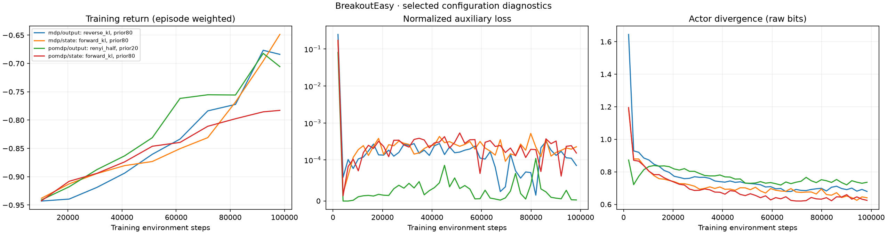

# BreakoutEasy: corrected posterior-head sweep

[Suite overview](../RESULTS.md) · [Heatmap](comparison.png) · [Vanilla LRU comparison](vs_vanilla_lru.md)

Scores are mean evaluation return ± episode SE over 64 episodes, conditional on training seed 0. Prior shares 20%/80% give auxiliary prior/posterior gradient weights 0.4/1.6 and 1.6/0.4. Both memory inputs enable residuals. Highest values are descriptive selections.

## MDP

| Divergence | Output, prior20 | Output, prior80 | State, prior20 | State, prior80 |
|---|---:|---:|---:|---:|
| Forward KL | [-0.6538 ± 0.0228](../BreakoutEasy/mdp/output/ib_forward_prior20_seed0/result.json) | [-0.7686 ± 0.0140](../BreakoutEasy/mdp/output/ib_forward_prior80_seed0/result.json) | [-0.6550 ± 0.0217](../BreakoutEasy/mdp/state/ib_forward_prior20_seed0/result.json) | [-0.6428 ± 0.0191](../BreakoutEasy/mdp/state/ib_forward_prior80_seed0/result.json) |
| Reverse KL | [-0.6843 ± 0.0153](../BreakoutEasy/mdp/output/ib_reverse_prior20_seed0/result.json) | [-0.6086 ± 0.0241](../BreakoutEasy/mdp/output/ib_reverse_prior80_seed0/result.json) | [-0.8036 ± 0.0091](../BreakoutEasy/mdp/state/ib_reverse_prior20_seed0/result.json) | [-0.7433 ± 0.0137](../BreakoutEasy/mdp/state/ib_reverse_prior80_seed0/result.json) |
| Symmetric KL | [-0.7284 ± 0.0144](../BreakoutEasy/mdp/output/ib_symmetric_prior20_seed0/result.json) | [-0.8010 ± 0.0113](../BreakoutEasy/mdp/output/ib_symmetric_prior80_seed0/result.json) | [-0.7361 ± 0.0151](../BreakoutEasy/mdp/state/ib_symmetric_prior20_seed0/result.json) | [-0.8474 ± 0.0086](../BreakoutEasy/mdp/state/ib_symmetric_prior80_seed0/result.json) |
| Rényi-½ | [-0.7898 ± 0.0133](../BreakoutEasy/mdp/output/ib_renyi_half_prior20_seed0/result.json) | [-0.6913 ± 0.0193](../BreakoutEasy/mdp/output/ib_renyi_half_prior80_seed0/result.json) | [-0.7411 ± 0.0135](../BreakoutEasy/mdp/state/ib_renyi_half_prior20_seed0/result.json) | [-0.8762 ± 0.0036](../BreakoutEasy/mdp/state/ib_renyi_half_prior80_seed0/result.json) |

## POMDP

| Divergence | Output, prior20 | Output, prior80 | State, prior20 | State, prior80 |
|---|---:|---:|---:|---:|
| Forward KL | [-0.8742 ± 0.0034](../BreakoutEasy/pomdp/output/ib_forward_prior20_seed0/result.json) | [-0.8198 ± 0.0099](../BreakoutEasy/pomdp/output/ib_forward_prior80_seed0/result.json) | [-0.8737 ± 0.0036](../BreakoutEasy/pomdp/state/ib_forward_prior20_seed0/result.json) | [-0.7672 ± 0.0087](../BreakoutEasy/pomdp/state/ib_forward_prior80_seed0/result.json) |
| Reverse KL | [-0.7422 ± 0.0139](../BreakoutEasy/pomdp/output/ib_reverse_prior20_seed0/result.json) | [-0.6868 ± 0.0181](../BreakoutEasy/pomdp/output/ib_reverse_prior80_seed0/result.json) | [-0.8529 ± 0.0091](../BreakoutEasy/pomdp/state/ib_reverse_prior20_seed0/result.json) | [-0.7940 ± 0.0084](../BreakoutEasy/pomdp/state/ib_reverse_prior80_seed0/result.json) |
| Symmetric KL | [-0.7738 ± 0.0108](../BreakoutEasy/pomdp/output/ib_symmetric_prior20_seed0/result.json) | [-0.8143 ± 0.0076](../BreakoutEasy/pomdp/output/ib_symmetric_prior80_seed0/result.json) | [-0.7799 ± 0.0095](../BreakoutEasy/pomdp/state/ib_symmetric_prior20_seed0/result.json) | [-0.8266 ± 0.0108](../BreakoutEasy/pomdp/state/ib_symmetric_prior80_seed0/result.json) |
| Rényi-½ | [-0.6607 ± 0.0151](../BreakoutEasy/pomdp/output/ib_renyi_half_prior20_seed0/result.json) | [-0.7178 ± 0.0150](../BreakoutEasy/pomdp/output/ib_renyi_half_prior80_seed0/result.json) | [-0.7971 ± 0.0093](../BreakoutEasy/pomdp/state/ib_renyi_half_prior20_seed0/result.json) | [-0.8725 ± 0.0036](../BreakoutEasy/pomdp/state/ib_renyi_half_prior80_seed0/result.json) |

## Training diagnostics

Each curve is the highest-evaluation-return configuration selected within one posterior-input/mode group. Selection uses the held-out evaluation and is exploratory. Training returns use five-update windows weighted by completed episodes; these are not held-out evaluation scores.

