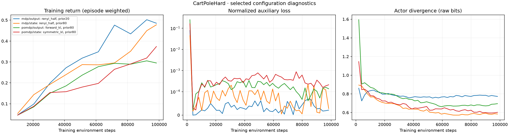

# CartPoleHard: corrected posterior-head sweep

[Suite overview](../RESULTS.md) · [Heatmap](comparison.png) · [Vanilla LRU comparison](vs_vanilla_lru.md)

Scores are mean evaluation return ± episode SE over 64 episodes, conditional on training seed 0. Prior shares 20%/80% give auxiliary prior/posterior gradient weights 0.4/1.6 and 1.6/0.4. Both memory inputs enable residuals. Highest values are descriptive selections.

## MDP

| Divergence | Output, prior20 | Output, prior80 | State, prior20 | State, prior80 |
|---|---:|---:|---:|---:|
| Forward KL | [0.4731 ± 0.0228](../CartPoleHard/mdp/output/ib_forward_prior20_seed0/result.json) | [0.4857 ± 0.0210](../CartPoleHard/mdp/output/ib_forward_prior80_seed0/result.json) | [0.4513 ± 0.0162](../CartPoleHard/mdp/state/ib_forward_prior20_seed0/result.json) | [0.3097 ± 0.0120](../CartPoleHard/mdp/state/ib_forward_prior80_seed0/result.json) |
| Reverse KL | [0.4186 ± 0.0192](../CartPoleHard/mdp/output/ib_reverse_prior20_seed0/result.json) | [0.4185 ± 0.0184](../CartPoleHard/mdp/output/ib_reverse_prior80_seed0/result.json) | [0.3948 ± 0.0166](../CartPoleHard/mdp/state/ib_reverse_prior20_seed0/result.json) | [0.3559 ± 0.0148](../CartPoleHard/mdp/state/ib_reverse_prior80_seed0/result.json) |
| Symmetric KL | [0.4852 ± 0.0203](../CartPoleHard/mdp/output/ib_symmetric_prior20_seed0/result.json) | [0.3705 ± 0.0155](../CartPoleHard/mdp/output/ib_symmetric_prior80_seed0/result.json) | [0.4186 ± 0.0153](../CartPoleHard/mdp/state/ib_symmetric_prior20_seed0/result.json) | [0.3197 ± 0.0120](../CartPoleHard/mdp/state/ib_symmetric_prior80_seed0/result.json) |
| Rényi-½ | [0.5267 ± 0.0223](../CartPoleHard/mdp/output/ib_renyi_half_prior20_seed0/result.json) | [0.3547 ± 0.0139](../CartPoleHard/mdp/output/ib_renyi_half_prior80_seed0/result.json) | [0.4785 ± 0.0183](../CartPoleHard/mdp/state/ib_renyi_half_prior20_seed0/result.json) | [0.5324 ± 0.0192](../CartPoleHard/mdp/state/ib_renyi_half_prior80_seed0/result.json) |

## POMDP

| Divergence | Output, prior20 | Output, prior80 | State, prior20 | State, prior80 |
|---|---:|---:|---:|---:|
| Forward KL | [0.2908 ± 0.0096](../CartPoleHard/pomdp/output/ib_forward_prior20_seed0/result.json) | [0.3350 ± 0.0150](../CartPoleHard/pomdp/output/ib_forward_prior80_seed0/result.json) | [0.2564 ± 0.0111](../CartPoleHard/pomdp/state/ib_forward_prior20_seed0/result.json) | [0.2790 ± 0.0139](../CartPoleHard/pomdp/state/ib_forward_prior80_seed0/result.json) |
| Reverse KL | [0.2803 ± 0.0127](../CartPoleHard/pomdp/output/ib_reverse_prior20_seed0/result.json) | [0.3223 ± 0.0183](../CartPoleHard/pomdp/output/ib_reverse_prior80_seed0/result.json) | [0.2896 ± 0.0148](../CartPoleHard/pomdp/state/ib_reverse_prior20_seed0/result.json) | [0.3124 ± 0.0153](../CartPoleHard/pomdp/state/ib_reverse_prior80_seed0/result.json) |
| Symmetric KL | [0.3135 ± 0.0169](../CartPoleHard/pomdp/output/ib_symmetric_prior20_seed0/result.json) | [0.3263 ± 0.0175](../CartPoleHard/pomdp/output/ib_symmetric_prior80_seed0/result.json) | [0.3301 ± 0.0133](../CartPoleHard/pomdp/state/ib_symmetric_prior20_seed0/result.json) | [0.3460 ± 0.0164](../CartPoleHard/pomdp/state/ib_symmetric_prior80_seed0/result.json) |
| Rényi-½ | [0.2941 ± 0.0141](../CartPoleHard/pomdp/output/ib_renyi_half_prior20_seed0/result.json) | [0.2976 ± 0.0113](../CartPoleHard/pomdp/output/ib_renyi_half_prior80_seed0/result.json) | [0.2939 ± 0.0158](../CartPoleHard/pomdp/state/ib_renyi_half_prior20_seed0/result.json) | [0.2813 ± 0.0153](../CartPoleHard/pomdp/state/ib_renyi_half_prior80_seed0/result.json) |

## Training diagnostics

Each curve is the highest-evaluation-return configuration selected within one posterior-input/mode group. Selection uses the held-out evaluation and is exploratory. Training returns use five-update windows weighted by completed episodes; these are not held-out evaluation scores.

