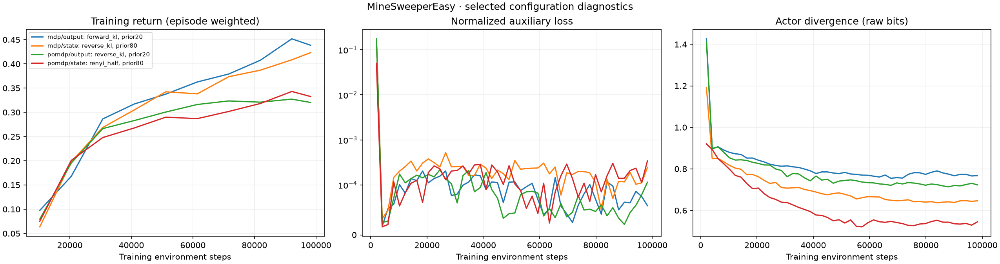

# MineSweeperEasy: corrected posterior-head sweep

[Suite overview](../RESULTS.md) · [Heatmap](comparison.png) · [Vanilla LRU comparison](vs_vanilla_lru.md)

Scores are mean evaluation return ± episode SE over 64 episodes, conditional on training seed 0. Prior shares 20%/80% give auxiliary prior/posterior gradient weights 0.4/1.6 and 1.6/0.4. Both memory inputs enable residuals. Highest values are descriptive selections.

## MDP

| Divergence | Output, prior20 | Output, prior80 | State, prior20 | State, prior80 |
|---|---:|---:|---:|---:|
| Forward KL | [0.5059 ± 0.0348](../MineSweeperEasy/mdp/output/ib_forward_prior20_seed0/result.json) | [0.4400 ± 0.0311](../MineSweeperEasy/mdp/output/ib_forward_prior80_seed0/result.json) | [0.4782 ± 0.0354](../MineSweeperEasy/mdp/state/ib_forward_prior20_seed0/result.json) | [0.3669 ± 0.0342](../MineSweeperEasy/mdp/state/ib_forward_prior80_seed0/result.json) |
| Reverse KL | [0.4554 ± 0.0347](../MineSweeperEasy/mdp/output/ib_reverse_prior20_seed0/result.json) | [0.3432 ± 0.0366](../MineSweeperEasy/mdp/output/ib_reverse_prior80_seed0/result.json) | [0.4442 ± 0.0356](../MineSweeperEasy/mdp/state/ib_reverse_prior20_seed0/result.json) | [0.4802 ± 0.0313](../MineSweeperEasy/mdp/state/ib_reverse_prior80_seed0/result.json) |
| Symmetric KL | [0.3396 ± 0.0375](../MineSweeperEasy/mdp/output/ib_symmetric_prior20_seed0/result.json) | [0.4562 ± 0.0338](../MineSweeperEasy/mdp/output/ib_symmetric_prior80_seed0/result.json) | [0.4593 ± 0.0338](../MineSweeperEasy/mdp/state/ib_symmetric_prior20_seed0/result.json) | [0.4470 ± 0.0363](../MineSweeperEasy/mdp/state/ib_symmetric_prior80_seed0/result.json) |
| Rényi-½ | [0.4104 ± 0.0346](../MineSweeperEasy/mdp/output/ib_renyi_half_prior20_seed0/result.json) | [0.3892 ± 0.0331](../MineSweeperEasy/mdp/output/ib_renyi_half_prior80_seed0/result.json) | [0.4434 ± 0.0386](../MineSweeperEasy/mdp/state/ib_renyi_half_prior20_seed0/result.json) | [0.4235 ± 0.0375](../MineSweeperEasy/mdp/state/ib_renyi_half_prior80_seed0/result.json) |

## POMDP

| Divergence | Output, prior20 | Output, prior80 | State, prior20 | State, prior80 |
|---|---:|---:|---:|---:|
| Forward KL | [0.2983 ± 0.0315](../MineSweeperEasy/pomdp/output/ib_forward_prior20_seed0/result.json) | [0.2712 ± 0.0274](../MineSweeperEasy/pomdp/output/ib_forward_prior80_seed0/result.json) | [0.3251 ± 0.0303](../MineSweeperEasy/pomdp/state/ib_forward_prior20_seed0/result.json) | [0.3181 ± 0.0329](../MineSweeperEasy/pomdp/state/ib_forward_prior80_seed0/result.json) |
| Reverse KL | [0.3530 ± 0.0271](../MineSweeperEasy/pomdp/output/ib_reverse_prior20_seed0/result.json) | [0.2930 ± 0.0281](../MineSweeperEasy/pomdp/output/ib_reverse_prior80_seed0/result.json) | [0.2974 ± 0.0308](../MineSweeperEasy/pomdp/state/ib_reverse_prior20_seed0/result.json) | [0.2852 ± 0.0282](../MineSweeperEasy/pomdp/state/ib_reverse_prior80_seed0/result.json) |
| Symmetric KL | [0.3220 ± 0.0311](../MineSweeperEasy/pomdp/output/ib_symmetric_prior20_seed0/result.json) | [0.3301 ± 0.0311](../MineSweeperEasy/pomdp/output/ib_symmetric_prior80_seed0/result.json) | [0.3451 ± 0.0334](../MineSweeperEasy/pomdp/state/ib_symmetric_prior20_seed0/result.json) | [0.3401 ± 0.0302](../MineSweeperEasy/pomdp/state/ib_symmetric_prior80_seed0/result.json) |
| Rényi-½ | [0.2634 ± 0.0314](../MineSweeperEasy/pomdp/output/ib_renyi_half_prior20_seed0/result.json) | [0.3083 ± 0.0314](../MineSweeperEasy/pomdp/output/ib_renyi_half_prior80_seed0/result.json) | [0.3019 ± 0.0296](../MineSweeperEasy/pomdp/state/ib_renyi_half_prior20_seed0/result.json) | [0.3742 ± 0.0299](../MineSweeperEasy/pomdp/state/ib_renyi_half_prior80_seed0/result.json) |

## Training diagnostics

Each curve is the highest-evaluation-return configuration selected within one posterior-input/mode group. Selection uses the held-out evaluation and is exploratory. Training returns use five-update windows weighted by completed episodes; these are not held-out evaluation scores.

