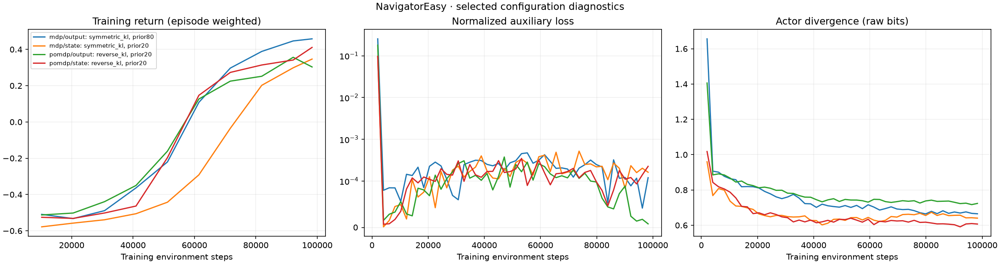

# NavigatorEasy: corrected posterior-head sweep

[Suite overview](../RESULTS.md) · [Heatmap](comparison.png) · [Vanilla LRU comparison](vs_vanilla_lru.md)

Scores are mean evaluation return ± episode SE over 64 episodes, conditional on training seed 0. Prior shares 20%/80% give auxiliary prior/posterior gradient weights 0.4/1.6 and 1.6/0.4. Both memory inputs enable residuals. Highest values are descriptive selections.

## MDP

| Divergence | Output, prior20 | Output, prior80 | State, prior20 | State, prior80 |
|---|---:|---:|---:|---:|
| Forward KL | [0.2644 ± 0.0916](../NavigatorEasy/mdp/output/ib_forward_prior20_seed0/result.json) | [0.1031 ± 0.0911](../NavigatorEasy/mdp/output/ib_forward_prior80_seed0/result.json) | [-0.1255 ± 0.0813](../NavigatorEasy/mdp/state/ib_forward_prior20_seed0/result.json) | [0.1218 ± 0.0918](../NavigatorEasy/mdp/state/ib_forward_prior80_seed0/result.json) |
| Reverse KL | [0.4034 ± 0.0881](../NavigatorEasy/mdp/output/ib_reverse_prior20_seed0/result.json) | [0.2173 ± 0.0916](../NavigatorEasy/mdp/output/ib_reverse_prior80_seed0/result.json) | [0.0488 ± 0.0907](../NavigatorEasy/mdp/state/ib_reverse_prior20_seed0/result.json) | [0.1179 ± 0.0934](../NavigatorEasy/mdp/state/ib_reverse_prior80_seed0/result.json) |
| Symmetric KL | [0.4625 ± 0.0853](../NavigatorEasy/mdp/output/ib_symmetric_prior20_seed0/result.json) | [0.4965 ± 0.0839](../NavigatorEasy/mdp/output/ib_symmetric_prior80_seed0/result.json) | [0.4194 ± 0.0906](../NavigatorEasy/mdp/state/ib_symmetric_prior20_seed0/result.json) | [0.2006 ± 0.0915](../NavigatorEasy/mdp/state/ib_symmetric_prior80_seed0/result.json) |
| Rényi-½ | [0.2734 ± 0.0914](../NavigatorEasy/mdp/output/ib_renyi_half_prior20_seed0/result.json) | [0.2614 ± 0.0914](../NavigatorEasy/mdp/output/ib_renyi_half_prior80_seed0/result.json) | [0.1320 ± 0.0920](../NavigatorEasy/mdp/state/ib_renyi_half_prior20_seed0/result.json) | [-0.4135 ± 0.0624](../NavigatorEasy/mdp/state/ib_renyi_half_prior80_seed0/result.json) |

## POMDP

| Divergence | Output, prior20 | Output, prior80 | State, prior20 | State, prior80 |
|---|---:|---:|---:|---:|
| Forward KL | [0.1735 ± 0.0910](../NavigatorEasy/pomdp/output/ib_forward_prior20_seed0/result.json) | [0.2072 ± 0.0916](../NavigatorEasy/pomdp/output/ib_forward_prior80_seed0/result.json) | [0.3121 ± 0.0921](../NavigatorEasy/pomdp/state/ib_forward_prior20_seed0/result.json) | [0.3756 ± 0.0880](../NavigatorEasy/pomdp/state/ib_forward_prior80_seed0/result.json) |
| Reverse KL | [0.3287 ± 0.0897](../NavigatorEasy/pomdp/output/ib_reverse_prior20_seed0/result.json) | [0.2806 ± 0.0904](../NavigatorEasy/pomdp/output/ib_reverse_prior80_seed0/result.json) | [0.4045 ± 0.0890](../NavigatorEasy/pomdp/state/ib_reverse_prior20_seed0/result.json) | [0.2964 ± 0.0911](../NavigatorEasy/pomdp/state/ib_reverse_prior80_seed0/result.json) |
| Symmetric KL | [-0.0280 ± 0.0868](../NavigatorEasy/pomdp/output/ib_symmetric_prior20_seed0/result.json) | [0.1559 ± 0.0914](../NavigatorEasy/pomdp/output/ib_symmetric_prior80_seed0/result.json) | [0.0327 ± 0.0898](../NavigatorEasy/pomdp/state/ib_symmetric_prior20_seed0/result.json) | [0.1259 ± 0.0909](../NavigatorEasy/pomdp/state/ib_symmetric_prior80_seed0/result.json) |
| Rényi-½ | [0.1432 ± 0.0922](../NavigatorEasy/pomdp/output/ib_renyi_half_prior20_seed0/result.json) | [0.0396 ± 0.0895](../NavigatorEasy/pomdp/output/ib_renyi_half_prior80_seed0/result.json) | [0.2201 ± 0.0918](../NavigatorEasy/pomdp/state/ib_renyi_half_prior20_seed0/result.json) | [0.3455 ± 0.0896](../NavigatorEasy/pomdp/state/ib_renyi_half_prior80_seed0/result.json) |

## Training diagnostics

Each curve is the highest-evaluation-return configuration selected within one posterior-input/mode group. Selection uses the held-out evaluation and is exploratory. Training returns use five-update windows weighted by completed episodes; these are not held-out evaluation scores.

