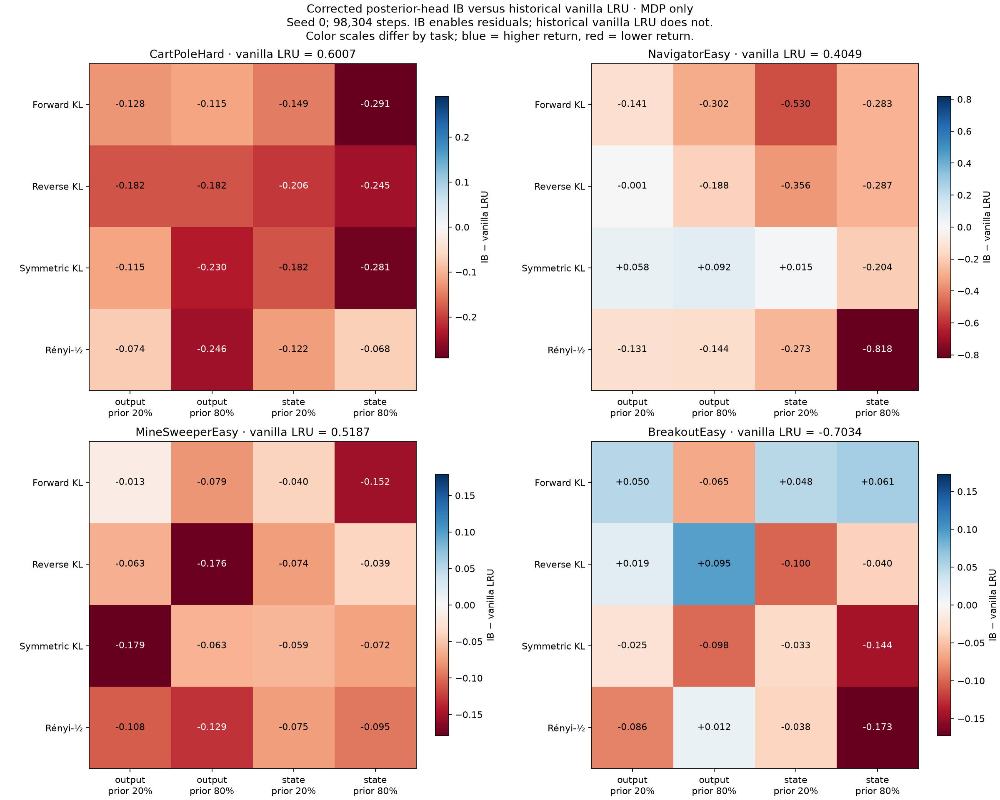

# Comparison with previous vanilla LRU

[Suite overview](../RESULTS.md) · [All 128 rows with baseline availability and deltas](vs_vanilla_lru.csv) · [Baseline provenance](vanilla_lru_provenance.json)

Previous vanilla LRU runs exist for the four **MDP** tasks only. The prior/posterior head error was confined to IB models: vanilla LRU uses current input plus projected LRU output and has no Gaussian head. Its historical scores remain usable as vanilla LRU references.

PPO configuration, task/mode, seed 0, 98,304 actual training steps, hidden/layers, 64 held-out evaluation episodes, JAX/dependency lock, and local GPU match. Raw baseline episode returns were rechecked against the stored mean, standard deviation, and SE. Sources retain their original hashes; the CartPole copy is counted once and MineSweeper's recovered evaluation is identified in the provenance file.

**Architecture difference:** historical vanilla LRU has no added inter-layer residual connection, whereas all corrected IB runs enable it. Vanilla heads consume current input plus a 256-dimensional projection of LRU output; IB heads consume current input plus posterior mean/log variance. Parameter counts are 6,940,422 for vanilla LRU versus 16,407,454 (output IB) or 24,794,014 (state IB). These comparisons do not isolate the divergence regularizer alone.

## Highest observed MDP scores

Highest IB scores are selected from 16 configurations per task. ± is episode SE for one trained seed, not training-seed uncertainty. Positive deltas mean higher raw return; no statistical-significance claim is made.

| Task | Vanilla LRU ± SE | Best corrected IB ± SE | IB − LRU | Best configuration | IB configs above LRU |
|---|---:|---:|---:|---|---:|
| CartPoleHard | [0.6007 ± 0.0210](../../vanilla_lru_baselines_20261109/CartPoleHard/mdp/lru_seed0/result.json) | 0.5324 ± 0.0192 | -0.0683 | renyi_half, state, prior80 | 0/16 |
| NavigatorEasy | [0.4049 ± 0.0879](../../vanilla_lru_baselines_20261109/NavigatorEasy/mdp/lru_seed0/result.json) | 0.4965 ± 0.0839 | +0.0916 | symmetric_kl, output, prior80 | 3/16 |
| MineSweeperEasy | [0.5187 ± 0.0371](../../vanilla_lru_baselines_20261109/MineSweeperEasy/mdp/lru_seed0/result.json) | 0.5059 ± 0.0348 | -0.0128 | forward_kl, output, prior20 | 0/16 |
| BreakoutEasy | [-0.7034 ± 0.0167](../../vanilla_lru_baselines_20261109/BreakoutEasy/mdp/lru_seed0/result.json) | -0.6086 ± 0.0241 | +0.0948 | reverse_kl, output, prior80 | 6/16 |

## All MDP deltas

Values are corrected IB mean return minus the same-task vanilla LRU mean. All runs have residuals enabled except the historical vanilla reference.

### CartPoleHard

| Divergence | Output, prior20 | Output, prior80 | State, prior20 | State, prior80 |
|---|---:|---:|---:|---:|
| forward_kl | -0.1276 | -0.1150 | -0.1494 | -0.2910 |
| reverse_kl | -0.1821 | -0.1822 | -0.2059 | -0.2448 |
| symmetric_kl | -0.1155 | -0.2302 | -0.1821 | -0.2810 |
| renyi_half | -0.0740 | -0.2460 | -0.1222 | -0.0683 |

### NavigatorEasy

| Divergence | Output, prior20 | Output, prior80 | State, prior20 | State, prior80 |
|---|---:|---:|---:|---:|
| forward_kl | -0.1405 | -0.3018 | -0.5304 | -0.2831 |
| reverse_kl | -0.0015 | -0.1876 | -0.3561 | -0.2870 |
| symmetric_kl | +0.0576 | +0.0916 | +0.0145 | -0.2043 |
| renyi_half | -0.1315 | -0.1436 | -0.2729 | -0.8184 |

### MineSweeperEasy

| Divergence | Output, prior20 | Output, prior80 | State, prior20 | State, prior80 |
|---|---:|---:|---:|---:|
| forward_kl | -0.0128 | -0.0787 | -0.0405 | -0.1518 |
| reverse_kl | -0.0633 | -0.1755 | -0.0745 | -0.0385 |
| symmetric_kl | -0.1791 | -0.0625 | -0.0594 | -0.0717 |
| renyi_half | -0.1083 | -0.1295 | -0.0753 | -0.0951 |

### BreakoutEasy

| Divergence | Output, prior20 | Output, prior80 | State, prior20 | State, prior80 |
|---|---:|---:|---:|---:|
| forward_kl | +0.0497 | -0.0652 | +0.0484 | +0.0606 |
| reverse_kl | +0.0191 | +0.0948 | -0.1002 | -0.0398 |
| symmetric_kl | -0.0250 | -0.0976 | -0.0327 | -0.1440 |
| renyi_half | -0.0864 | +0.0121 | -0.0377 | -0.1728 |

## POMDP coverage

New POMDP baselines are available in the [consolidated vanilla LRU archive](../../vanilla_lru_baselines_20261109/RESULTS.md). The comparison CSV now includes both observation modes with their own baselines. No MDP baseline is substituted for POMDP.
